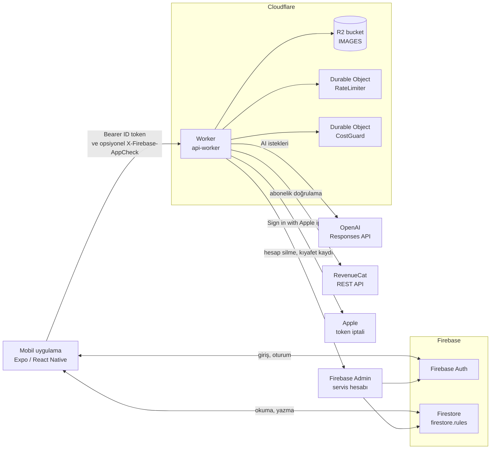
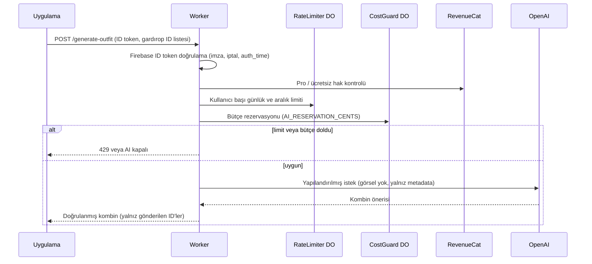
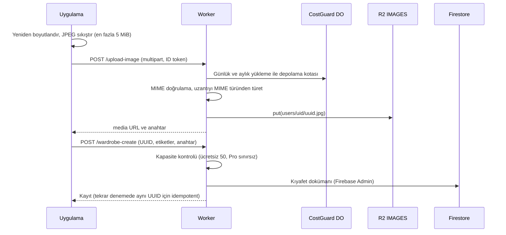

# Ne giysem?

Gardırobunu dijitalleştiren, yapay zekâ destekli kombin önerileri sunan ve topluluğa açık stil panoları paylaşmanı sağlayan mobil stil uygulaması.


## Özellikler

- Gardırop: kıyafet fotoğrafı yükle, parçaları kategori, renk, desen ve mevsime göre düzenle
- Yapay zekâ ile fotoğraf analizi (Pro): kategori, renk, desen, kesim, mevsim ve stil tahmini
- AI stil danışmanı: gardırobundaki parçalardan sohbet ederek kombin önerisi al
- Kombin geçmişi ve ruh hali panoları (mood board), kolaj görünümü
- Keşfet akışı: paylaşım, beğeni, yorum, takip, bildirimler
- Güvenlik ve moderasyon: gönderi/yorum bildirme, kullanıcı engelleme, kelime filtresi
- Giriş: e-posta/şifre, Google, Sign in with Apple; kalıcı oturum için SecureStore
- Ne Giysem Pro: RevenueCat ile abonelik; ücretsiz planda 50 parça ve 3 sohbet
- Hesap silme: tüm Firestore verisi, R2 görselleri ve Apple yetkisinin iptali
- Açılışta iki kapaklı vintage dolap animasyonu (Reduce Motion uyumlu)

## Ekran görüntüleri

Görselleri `docs/screenshots/` altına ekle; aşağıdaki tablo dosya adlarını bekler.

| Gardırop | AI Sohbet | Keşfet | Pro |
|---|---|---|---|
|  |  |  |  |

## Mimari



İlkeler: istemci yalnızca `EXPO_PUBLIC_*` (public) değerleri bilir; tüm secret'lar Worker'dadır. Görseller özel R2'de durur ve yalnızca Worker üzerinden yüklenir/okunur. Kıyafet kaydı yalnızca Worker'dan geçer; Pro yetkisi RevenueCat REST ile sunucuda doğrulanır.

### AI kombin önerisi (`/generate-outfit`)



### Görsel yükleme (`/upload-image` sonra `/wardrobe-create`)



## Önkoşullar

- Node.js LTS (CI Node 22 kullanır) ve npm
- Java 21+ ve Firebase CLI (`npm i -g firebase-tools`): yalnızca `npm run test:rules` için
- `wrangler login` yapılmış Cloudflare hesabı (Worker, R2, Durable Objects)
- EAS hesabı (`npm i -g eas-cli`, `eas login`)
- Python 3 ve Pillow: yalnızca `scripts/generate_icons.py` ikon betiği için
- Apple Developer hesabı (Sign in with Apple, TestFlight) ve RevenueCat projesi

## Yerel geliştirme

```sh
npm ci
npm --prefix api-worker ci
cp .env.example .env.local        # değerleri kendi projenle doldur
cp api-worker/.dev.vars.example api-worker/.dev.vars   # Worker secret'ları (gitignore'da)
npm run worker:dev                # Worker yerelde başlar (genellikle http://localhost:8787)
```

1. `.env.local` içinde `EXPO_PUBLIC_WORKER_URL` değerini yerel Worker adresine yönelt (fiziksel cihazdan erişim için bilgisayarının LAN IP'sini kullan).
2. RevenueCat ve Sign in with Apple native modül gerektirir; **Expo Go ile çalışmaz**. Development build al: `eas build --profile development --platform ios`, ardından `npm start` ile Metro'ya bağlan.
3. E-posta/şifre, Google ve Apple sağlayıcılarını Firebase Console'da etkinleştir. Google istemci kimlikleri doğru iOS bundle ID / Android paketine bağlı olmalı.
4. Kalite kontrolleri: `npm run lint`, `npm test`.

## Ortam değişkenleri

### İstemci (`EXPO_PUBLIC_*`, pakete gömülür, public)

Yerelde `.env.local`; EAS bulut build'inde EAS environment (aşağıya bakın).

| Ad | Kapsam | Zorunlu | Varsayılan | Nereden |
|---|---|---|---|---|
| `EXPO_PUBLIC_WORKER_URL` | İstemci | Evet | yok | Yayımlanmış Worker HTTPS adresi |
| `EXPO_PUBLIC_FIREBASE_API_KEY` | İstemci | Evet | yok | Firebase Console, web uygulaması |
| `EXPO_PUBLIC_FIREBASE_AUTH_DOMAIN` | İstemci | Evet | yok | Firebase Console, web uygulaması |
| `EXPO_PUBLIC_FIREBASE_PROJECT_ID` | İstemci | Evet | yok | Firebase Console (Worker `FIREBASE_PROJECT_ID` ile aynı) |
| `EXPO_PUBLIC_FIREBASE_APP_ID` | İstemci | Evet | yok | Firebase Console, web uygulaması |
| `EXPO_PUBLIC_FIREBASE_MESSAGING_SENDER_ID` | İstemci | Evet | yok | Firebase Console, web uygulaması |
| `EXPO_PUBLIC_GOOGLE_WEB_CLIENT_ID` | İstemci | Google girişi için | yok | Google Cloud OAuth |
| `EXPO_PUBLIC_GOOGLE_IOS_CLIENT_ID` | İstemci | Google girişi için | yok | Google Cloud OAuth |
| `EXPO_PUBLIC_GOOGLE_ANDROID_CLIENT_ID` | İstemci | Google girişi için | yok | Google Cloud OAuth |
| `EXPO_PUBLIC_REVENUECAT_IOS_KEY` | İstemci | Pro / release için | yok | RevenueCat public SDK key (`appl_...`) |
| `EXPO_PUBLIC_REVENUECAT_ANDROID_KEY` | İstemci | Android Pro için | yok | RevenueCat public SDK key (`goog_...`) |
| `EXPO_PUBLIC_REVENUECAT_MONTHLY_PRODUCT_ID` | İstemci | Hayır | `ne_giysem_pro_monthly` | App Store Connect |
| `EXPO_PUBLIC_REVENUECAT_YEARLY_PRODUCT_ID` | İstemci | Hayır | `ne_giysem_pro_yearly` | App Store Connect |
| `EXPO_PUBLIC_PRIVACY_URL` | İstemci | Release için | yok | Yayımladığın gizlilik sayfası (HTTPS) |
| `EXPO_PUBLIC_TERMS_URL` | İstemci | Release için | yok | Yayımladığın koşullar sayfası (HTTPS) |
| `EXPO_PUBLIC_SUPPORT_EMAIL` | İstemci | Hayır | koddaki varsayılan | Destek adresin (ör. `support@your-domain.example`) |
| `EXPO_PUBLIC_SENTRY_DSN` | İstemci | Hayır | boş (kapalı) | Sentry proje ayarları, Client Keys (DSN) |

`npm run check:release` release için zorunlu olanları (Firebase çekirdeği, Worker URL, gizlilik/koşul URL'leri, RevenueCat iOS anahtarı) denetler. Secret'ı `EXPO_PUBLIC_` önekiyle ekleme.

### Worker secret'ları

`cd api-worker && npx wrangler secret put <AD>`; yerelde `api-worker/.dev.vars`.

| Ad | Kapsam | Zorunlu | Varsayılan | Nereden |
|---|---|---|---|---|
| `OPENAI_API_KEY` | Worker secret | Evet (AI için) | yok | OpenAI projesi API key (bu uygulamaya özel proje) |
| `FIREBASE_SERVICE_ACCOUNT` | Worker secret | Evet | yok | Firebase servis hesabı JSON (`project_id` eşleşmeli; en az yetki, Owner/Editor verme) |
| `REVENUECAT_SECRET_KEY` | Worker secret | Evet (Pro için) | yok | RevenueCat v1 secret API key |
| `APPLE_TEAM_ID` | Worker secret | Apple hesap silme için | yok | Apple Developer hesabı |
| `APPLE_KEY_ID` | Worker secret | Apple hesap silme için | yok | Sign in with Apple anahtarı |
| `APPLE_CLIENT_ID` | Worker secret | Apple hesap silme için | yok | Native bundle ID |
| `APPLE_PRIVATE_KEY` | Worker secret | Apple hesap silme için | yok | Apple `.p8` anahtar içeriği |

### Worker değişkenleri (`api-worker/wrangler.toml` `[vars]`)

| Ad | Kapsam | Zorunlu | Varsayılan | Nereden / açıklama |
|---|---|---|---|---|
| `ALLOWED_ORIGINS` | Worker var | Evet | yer tutucu | Gerçek web origin'in (native istemci Origin göndermeyebilir) |
| `FIREBASE_PROJECT_ID` | Worker var | Evet | proje kimliği | Firebase Console |
| `FIREBASE_WEB_API_KEY` | Worker var | Evet | wrangler.toml | Firebase web API key. Public anahtardır, bu yüzden secret değil var olarak tutulur; ancak GCP'de **yalnızca Identity Toolkit API** ile kısıtlanmalı |
| `FIREBASE_PROJECT_NUMBER` | Worker var | App Check için | boş | Firebase Console, Project settings |
| `APP_CHECK_ENFORCE` | Worker var | Hayır | `"false"` (soft mod) | `"true"` yapınca geçersiz App Check token'ı reddedilir |
| `REVENUECAT_ENTITLEMENT` | Worker var | Evet | `pro` | RevenueCat entitlement adı |
| `REVENUECAT_ALLOW_SANDBOX` | Worker var | Evet | `"false"` | Üretimde `false` kalmalı |
| `REVENUECAT_SANDBOX_USER_IDS` | Worker var | Hayır | boş | App Review / TestFlight Firebase UID'leri |
| `AI_ENABLED` | Worker var | Evet | `"true"` | `"false"` acil durdurma |
| `OPENAI_MODEL` | Worker var | Hayır | `"gpt-6-luna"` | OpenAI model adı (kodda sabit değil) |
| `AI_MONTHLY_BUDGET_CENTS` | Worker var | Evet | `"500"` | Tüm uygulama için aylık AI bütçesi (cent) |
| `AI_RESERVATION_CENTS` | Worker var | Hayır | `"1"` | AI denemesi başına rezerve edilen cent |
| `AI_USER_DAILY_LIMIT` | Worker var | Hayır | `"25"` | Kullanıcı başına günlük AI denemesi |
| `AI_DAILY_REQUEST_LIMIT` | Worker var | Evet | `"500"` | Global günlük AI isteği |
| `AI_MONTHLY_REQUEST_LIMIT` | Worker var | Evet | `"1000"` | Global aylık AI isteği |
| `UPLOAD_USER_DAILY_LIMIT` | Worker var | Hayır | `"10"` | Kullanıcı başına günlük yükleme |
| `UPLOAD_DAILY_GLOBAL_LIMIT` | Worker var | Hayır | `"1000"` | Global günlük yükleme |
| `STORAGE_MONTHLY_BYTES_LIMIT` | Worker var | Hayır | `"5368709120"` (5 GiB) | Aylık global yükleme baytı; silinen yüklemeler iade edilir |

Tam ve güncel varsayılanlar için `api-worker/wrangler.toml` ve `api-worker/src/costGuard.ts` dosyalarına bak. Bindings: R2 `IMAGES` (`negiysem-storage`), Durable Objects `RATE_LIMITER` ve `COST_GUARD`.

### EAS ile production ortam değişkenleri

`.env` ve `.env*.local` dosyaları `.gitignore` içindedir, bu yüzden **EAS bulut build'i bunları görmez**. Production build öncesi `EXPO_PUBLIC_*` değerlerini EAS'a yükle:

```sh
eas env:create --environment production --name EXPO_PUBLIC_WORKER_URL --value "https://..." --visibility plaintext
# her EXPO_PUBLIC_* için tekrarla
eas env:list --environment production
```

`eas.json` içindeki profiller (`development`, `preview`, `production`) aynı adlı EAS ortamını kullanır. Production build, `check:release` kontrolünü çalıştırır ve eksik değerde başarısız olur. Ayrıntı: [docs/PRODUCTION_TESTFLIGHT_CHECKLIST.md](docs/PRODUCTION_TESTFLIGHT_CHECKLIST.md).

## Güvenli yayın sırası

1. [Güvenlik ve yayın raporunu](docs/SECURITY_RELEASE_REVIEW.md) oku. Mevcut veri şemalarını ve eski istemcileri staging ortamında kontrol et.
2. `api-worker/wrangler.toml`: Firebase web API key, proje kimliği (ve App Check için proje numarası), R2 bucket, origin izinlerini doldur. Native istemciler Origin göndermeyebilir; asıl koruma kimlik doğrulamadır. Google Cloud Console'da web API key'ine API kısıtlaması koy (yalnızca Identity Toolkit API).
3. Worker secret'larını Cloudflare'a ekle. Mobil pakete secret koyma:

```sh
cd api-worker
npx wrangler secret put OPENAI_API_KEY
npx wrangler secret put FIREBASE_SERVICE_ACCOUNT
npx wrangler secret put REVENUECAT_SECRET_KEY
npx wrangler secret put APPLE_TEAM_ID
npx wrangler secret put APPLE_KEY_ID
npx wrangler secret put APPLE_CLIENT_ID
npx wrangler secret put APPLE_PRIVATE_KEY
npm run deploy
```

`FIREBASE_SERVICE_ACCOUNT`, aynı projeye ait JSON servis hesabıdır; hesap silme için yalnızca gereken Firestore IAM yetkilerini ver (ör. `roles/datastore.user`), Owner/Editor verme. Firebase Auth silme kullanıcının güncel ID token'ıyla yapılır. Apple client ID native bundle ID ile eşleşir; private key Apple'ın Sign in with Apple anahtarıdır.

4. Kuralları ve indeksleri birlikte yayımla:

```sh
firebase deploy --only firestore:rules,firestore:indexes --project GERCEK_PROJE_ID
```

5. EAS production ortam değişkenlerini yükle (yukarıya bak), konsolda faturalandırma korumalarını doğrula, iki ayrı hesapla TestFlight testlerini tamamla. `npm run check:release` eksik yapılandırmayı reddeder; production EAS build aynı kontrolü çalıştırır.
6. Moderasyon sürecini kur ([SECURITY_RELEASE_REVIEW.md](docs/SECURITY_RELEASE_REVIEW.md), "İçerik moderasyonu"); Apple 1.2 için bildirimleri düzenli incelemen gerekir. App Check için [docs/APP_CHECK_SETUP.md](docs/APP_CHECK_SETUP.md).

## Limitler ve kotalar

| Konu | Sınır |
|---|---|
| AI bütçesi | Tüm uygulama için 5 USD/UTC ay (`AI_MONTHLY_BUDGET_CENTS=500`); kullanıcı başına değildir |
| AI rezervasyonu | Her deneme `AI_RESERVATION_CENTS` (varsayılan 1 cent) tüketir; başarı/hata/iptal iade etmez. 5 USD bütçeyle en fazla 500 deneme/ay |
| AI kullanıcı başına | `AI_USER_DAILY_LIMIT` (25/gün), denemeler arası 8 saniye |
| AI global | `AI_DAILY_REQUEST_LIMIT` 500/gün, `AI_MONTHLY_REQUEST_LIMIT` 1000/ay |
| Acil durdurma | `AI_ENABLED="false"` |
| Yükleme boyutu | 5 MiB/dosya (istemcide yeniden boyutlandırılır) |
| Yükleme kullanıcı başına | `UPLOAD_USER_DAILY_LIMIT` (10/gün), yüklemeler arası 3 saniye |
| Yükleme global | `UPLOAD_DAILY_GLOBAL_LIMIT` (1000/gün), aylık günlük limit × 30; kullanıcı başı ayrıca 50 MiB/gün |
| Depolama | Aylık `STORAGE_MONTHLY_BYTES_LIMIT`; silinen yüklemeler iade edilir. Eski 250 MiB kullanıcı başı ve 5 GiB kalıcı kümülatif sınırlar kaldırıldı |
| Medya okuma | Global 5000/gün, 100000/ay |
| Ücretsiz plan | 50 gardırop parçası, hesap başına toplam 3 AI sohbet; Pro'da parça sınırı yok |
| Firestore yazma | Kullanıcı başına standart yazmalar 150/gün; sohbet 50 mesaj; AI gardırop özeti 100 parça |

Bütçeyi artırmak için Worker değişkenini ve OpenAI proje hard limitini güncelle; **App Store'a yeni sürüm göndermek gerekmez**. Sayaçları veya `global-budget-v1` nesne adını değiştirme. OpenAI Console'da ayrı proje için hard spend limit ayarla; Worker sayacı başka anahtarların harcamasını görmez. Firestore için Spark, Worker/SQLite Durable Objects için Free planı doğrula; Blaze bütçe uyarısı harcamayı kesmez. R2 ücretsiz kotası hesap geneldir. Kod plan durumunu değiştirmez veya doğrulamaz. Hesap silme/gizlilikten vazgeçme günlük yazma kotasından muaftır.

## Testler

| Komut | Kapsam |
|---|---|
| `npm test` | Aşağıdakilerin hepsi (typecheck, servis, güvenlik, Pro); ücretli OpenAI çağrısı yapmaz |
| `npm run lint` | ESLint |
| `npm run typecheck` | Uygulama TypeScript tip denetimi |
| `npm run typecheck:worker` | Worker TypeScript tip denetimi |
| `npm run test:analysis` | AI fotoğraf analizi istemci katmanı (`test-analyze.cjs`) |
| `npm run test:recommend` | Kombin öneri servisi ve gardırop ID doğrulaması |
| `npm run test:outfit-rules` | Kombin kuralları (Worker `outfitRules`) |
| `npm run test:chat-sessions` | Sohbet oturumu saklama ve mesaj sınırları |
| `npm run test:r2` | R2 depolama/yükleme istemci akışı |
| `npm run test:rate-limit` | RateLimiter / CostGuard sayaç mantığı |
| `npm run test:worker-client` | İstemcinin Worker API çağrıları ve hata eşlemeleri |
| `npm run test:avatar` | Avatar yükleme ve medya URL kuralları |
| `npm run test:security` | Worker güvenliği, SecureStore kalıcılığı, hesap silme |
| `npm run test:pro` | Pro / abonelik doğrulama ve kapasite kuralları |
| `npm run test:rules` | Firestore kuralları (Java 21+ ve Firebase CLI, yerel emülatör, demo proje) |
| `npm run check:release` | Statik yayın yapılandırması kontrolü |
| `npm run test:cloud-build` | `expo export` ile iOS bundle denemesi |

```sh
npx expo-doctor
npx expo export --platform ios --platform android
npm audit
npm --prefix api-worker audit
```

Export başarısı imzalı iOS build, Apple sağlayıcı kurulumu veya TestFlight testi yerine geçmez. GitHub Actions CI (`.github/workflows/ci.yml`) `npm ci`, `lint` ve `npm test` çalıştırır; emülatör testi isteğe bağlı iştir. Bilinen bağımlılık uyarıları ve kalan yayın adımları [raporda](docs/SECURITY_RELEASE_REVIEW.md).

## Proje yapısı

```text
.
├── App.tsx                  # Giriş noktası
├── app.json, eas.json       # Expo ve EAS yapılandırması
├── firestore.rules          # Güvenlik kuralları
├── firestore.indexes.json
├── r2-cors.example.json
├── src/
│   ├── auth/                # Firebase Auth, Apple, hata çevirileri
│   ├── billing/             # RevenueCat ve abonelik context'i
│   ├── components/          # Ortak UI bileşenleri
│   ├── config/              # env, Firebase, SecureStore kalıcılığı
│   ├── data/                # Firestore erişim katmanı
│   ├── navigation/
│   ├── screens/
│   ├── services/            # Worker API, AI, görsel, telemetri
│   ├── theme/
│   └── utils/               # sanitize vb.
├── api-worker/              # Cloudflare Worker (R2, OpenAI, RevenueCat, Apple, DO)
│   ├── src/
│   └── wrangler.toml
├── scripts/                 # Test ve release betikleri, ikon üretimi
├── docs/                    # Yayın, güvenlik, App Check, Pro notları
└── .github/workflows/ci.yml
```

## Ne Giysem Pro ve dolap açılışı

Sürüm iki kapaklı dolap açılışı, 50 parçalık ücretsiz gardırop, hesap başına toplam 3 ücretsiz sohbet ve sunucuda doğrulanan RevenueCat Pro erişimi içerir. Kurulum, kapasite sınırları, mağaza inceleme hesapları ve test sonuçları için [Pro yayın notlarına](docs/PRO_RELEASE_NOTES.md) bak. Ürün/anahtar yapılandırması olmadan gerçek satın alma açılmaz.

Destek: `support@your-domain.example` (kendi destek adresinle değiştir; `EXPO_PUBLIC_SUPPORT_EMAIL`). Gizlilik ve koşul metinleri gerçek işletmeci bilgisiyle yayımlanmış HTTPS sayfalarına yönelmelidir.

## Lisans

Lisans henüz belirlenmedi (TODO: `LICENSE` dosyası ekle).

## English summary

**Ne giysem?** ("What should I wear?") is an Expo / React Native wardrobe and AI stylist app. Users photograph their clothes, get AI-suggested outfits, build mood boards and share them in a community feed. The client talks to Firebase Auth and Firestore (protected by `firestore.rules`) and to a Cloudflare Worker (`api-worker/`) that fronts private R2 image storage, OpenAI, RevenueCat, Firebase Admin and Apple token revocation, with Durable Objects for rate limiting and cost guarding. Only `EXPO_PUBLIC_*` values ship in the app; all secrets live in the Worker.

Quick start: `npm ci && npm --prefix api-worker ci`, copy `.env.example` to `.env.local` and `api-worker/.dev.vars.example` to `api-worker/.dev.vars`, run `npm run worker:dev`, point `EXPO_PUBLIC_WORKER_URL` to it and use an EAS development build (Expo Go cannot run RevenueCat or Apple sign-in). Run `npm run lint` and `npm test` before pushing. For production builds set the `EXPO_PUBLIC_*` variables with `eas env:create --environment production`, since `.env` files are not uploaded to EAS. See the tables above for all environment variables, limits and tests.
